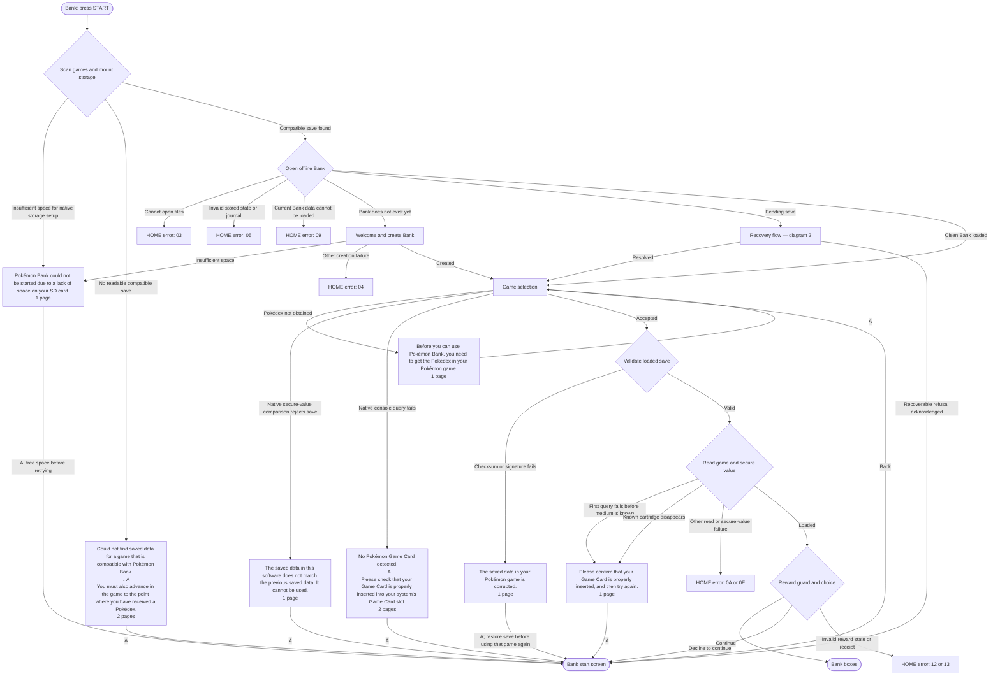
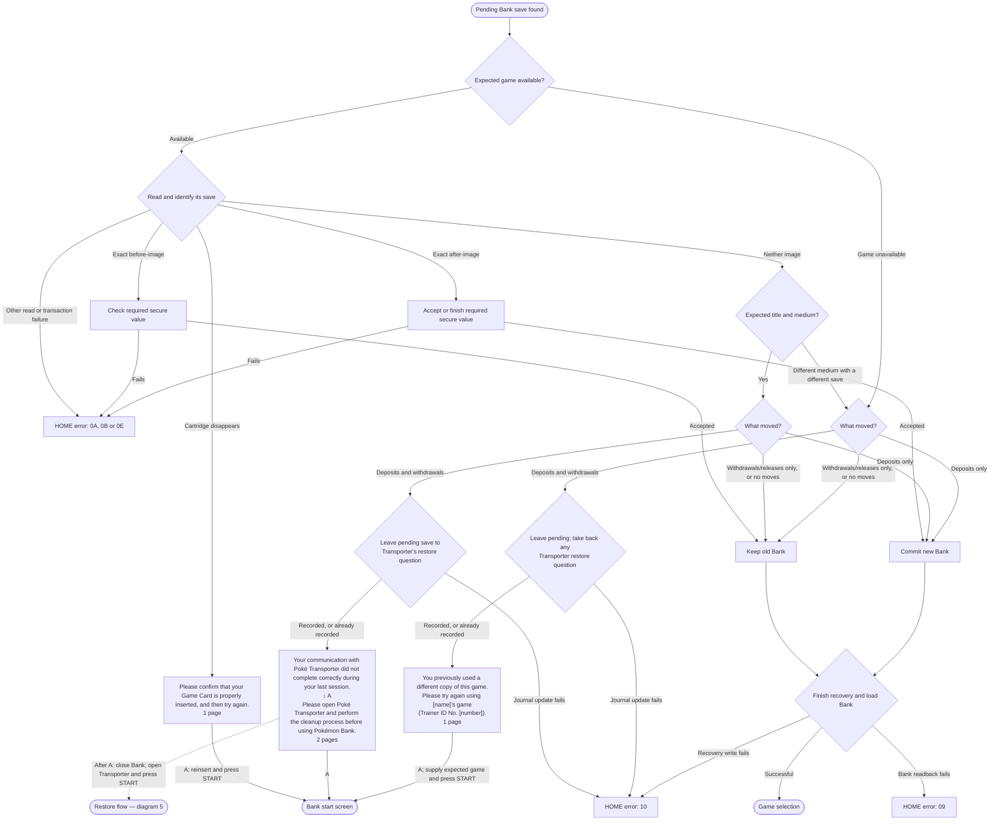
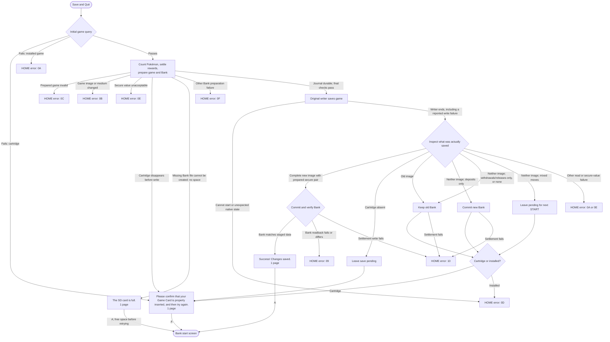
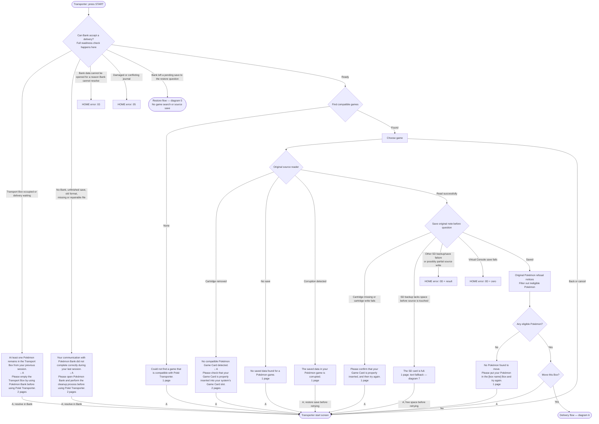
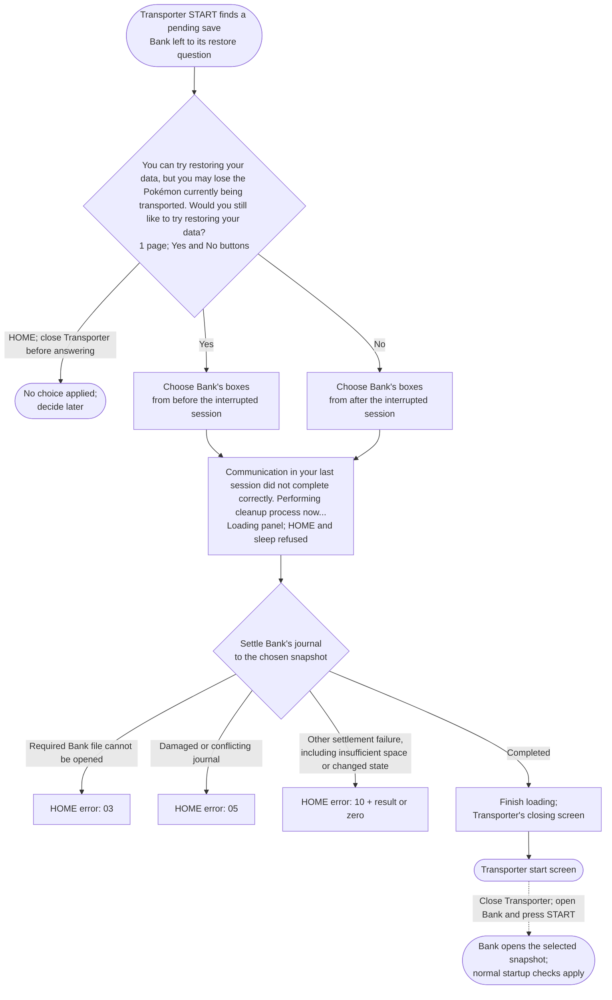
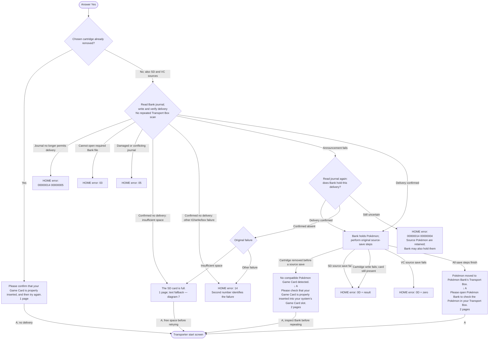
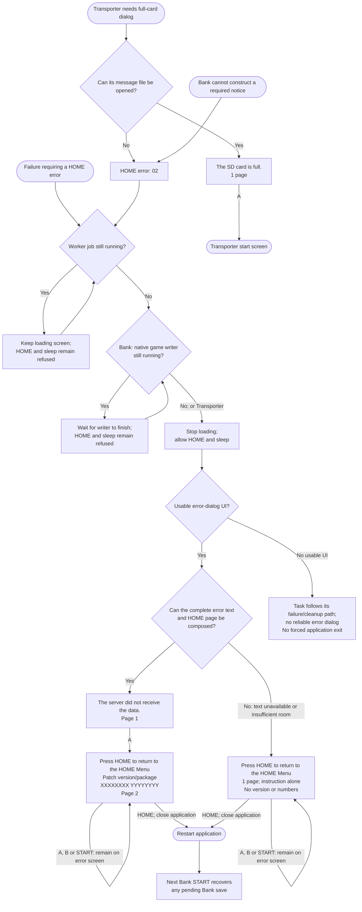

# Error cases and user flows

Every way a job of the normal offline patches can fail, and what the user sees and does next, with the original's game-selection and save-reading refusals the patches keep and the restore question for an interrupted Bank save. The user guides ([bank.md](bank.md), [transporter.md](transporter.md)) explain the cases; this map shows every screen and number in one place. Dialog text and page counts below describe English; the application uses the console's language. An arrow marked **A** means acknowledging the final page, after any earlier pages. Error numbers are hexadecimal. Every HOME error leads to diagram 7.

## How to read the map

- **Return to START** means the current session ends through Bank's cleanup or Transporter's closing task. The app stays open and START can be pressed again.
- **Return to selection** means Bank keeps its game-selection screen available.
- **HOME error** ends the current run. A advances to its final page but cannot dismiss it. Press HOME, close the app, and restart it.
- Every unexpected patch, storage, clock, or native-object failure in any stage goes to the shared HOME error, even where that arrow is omitted to keep the diagrams readable. Its first number identifies the stage; the table at the end covers every active fault.
- A failed write does not itself prove corruption. A later read/validation decides whether the corruption dialog appears.
- “Bank unchanged” in delivery decisions means no new delivery is announced. An unused file may have been partially written. Transporter's earlier note save may already have changed the source save, even when its Pokémon are unchanged.

## Dialog key: exact English text and pages

| Name used in diagrams | Full text, in page order | Pages and original message |
| --- | --- | --- |
| Retry | “Please confirm that your Game Card is properly inserted, and then try again.” | 1 displayed page; Bank 39:0x0B or Transporter 23:0x0B, second part only |
| Full SD | “The SD card is full.” | 1 displayed page; 26:0x00, first line only |
| Bank startup space | “Pokémon Bank could not be started due to a lack of space on your SD card.” | 1; 39:0x26 |
| Corrupt save | “The saved data in your Pokémon game is corrupted.” | 1; 23:0x02, also available in Bank's text archive |
| Waiting for game | “You previously used a different copy of this game. Please try again using [name]’s game (Trainer ID No. [number]).” | 1; 39:0x0A; name/ID come from the pending save |
| Open Transporter | **1:** “Your communication with Poké Transporter did not complete correctly during your last session.” **2:** “Please open Poké Transporter and perform the cleanup process before using Pokémon Bank.” | 2; 39:0x05 |
| Restore question | “You can try restoring your data, but you may lose the Pokémon currently being transported. Would you still like to try restoring your data?” | 1 with Yes/No buttons; 23:0x1A |
| Restore loading | “Communication in your last session did not complete correctly. Performing cleanup process now...” | 1 loading panel, no acknowledgement; 23:0x04 |
| No Bank game | **1:** “Could not find saved data for a game that is compatible with Pokémon Bank.” **2:** “You must also advance in the game to the point where you have received a Pokédex.” | 2 displayed pages; 39:0x00, first two pages only |
| Pokédex required | “Before you can use Pokémon Bank, you need to get the Pokédex in your Pokémon game.” | 1; 39:0x1A |
| Old save mismatch | “The saved data in this software does not match the previous saved data. It cannot be used.” | 1; 39:0x04 |
| Bank no card | **1:** “No Pokémon Game Card detected.” **2:** “Please check that your Game Card is properly inserted into your system’s Game Card slot.” | 2; 39:0x1F |
| No Transporter game | “Could not find a game that is compatible with Poké Transporter.” | 1; 23:0x00 |
| No source save | “No saved data found for a Pokémon game.” | 1; 23:0x24 |
| Transporter no card | **1:** “No compatible Pokémon Game Card detected.” **2:** “Please check that your Game Card is properly inserted into your system’s Game Card slot.” | 2; 23:0x22 |
| Open Bank | **1:** “Your communication with Pokémon Bank did not complete correctly during your last session.” **2:** “Please open Pokémon Bank and perform the cleanup process before using Poké Transporter.” | 2; 23:0x03 |
| Empty Transport Box | **1:** “At least one Pokémon remains in the Transport Box from your previous session.” **2:** “Please empty the Transport Box by using Pokémon Bank before using Poké Transporter.” | 2; 23:0x05 |
| No Pokémon | “No Pokémon found to move. Please put your Pokémon in the [box name] Box and try again.” | 1; 23:0x08; the box name is substituted by the original |
| Bank success | “Success! Changes saved.” | 1; 39:0x09 |
| Transporter success | **1:** “Pokémon moved to Pokémon Bank’s Transport Box.” **2:** “Please open Pokémon Bank to check the Pokémon in your Transport Box.” | 2; 23:0x0A; this is the normal success path |
| HOME error | **1:** “The server did not receive the data.” **2:** “Press HOME to return to the HOME Menu”, with the patch version/package on the next line and both eight-digit numbers below it. | 2 composed pages; Bank 39:0x0B first part + 39:0x4D; Transporter 23:0x0B first part + 23:0x27 |
| HOME instruction alone | “Press HOME to return to the HOME Menu” | 1 page, without version or numbers; fallback when the complete error text cannot be composed |

The HOME error uses the original server sentence as a general failure sentence. It does not mean that an offline server request was attempted. The English HOME button glyph is written as HOME here. The transformed retry and HOME dialogs also handle Simplified Chinese, where the original separates the parts by a line rather than a page.

## 1. Bank: startup and choosing a game

The first-query exception applies at the patch's load, before the query has identified cartridge versus installed copy. The earlier native selection has its own no-card dialog. A failure later in a load is treated as a missing card only for a known cartridge; an installed game's failure gets numbers.

An inserted cartridge takes precedence over an installed copy of the same title. For a pending installed save hidden by such a cartridge, remove the cartridge before START. For a pending cartridge save, insert it. Exact matching save images can identify the pending transaction on either medium; a different image on the other medium does not substitute for its missing game.

If **no readable compatible game at all** is available, the scan stops before pending recovery. The waiting-for-game dialog therefore requires the scan to have found some readable compatible game.

## 2. Bank: recovering a pending save at START

| What can be established | Bank result | Next user step |
| --- | --- | --- |
| Game is exactly the before-image and its secure value is acceptable | Keep old Bank | Game selection |
| Game is exactly the after-image and its secure value can be accepted/finished | Commit new Bank | Game selection |
| Neither exact image; expected title and medium are present; deposits only | Commit new Bank | Game selection; a damaged game is refused if selected |
| Neither exact image; expected title and medium are present; only withdrawals/releases, or no moves | Keep old Bank | Game selection; a damaged game is refused if selected |
| Neither exact image; expected title and medium are present; deposits and withdrawals | Leave pending and record that Transporter must ask | Two-page instruction → A → Bank start screen; then manually close Bank and open Transporter for diagram 5 |
| Game missing or different medium with a different image; deposits only | Commit new Bank | Game selection |
| Game missing or different medium with a different image; withdrawals/releases only, or no moves | Keep old Bank | Game selection |
| Game missing or different medium with a different image; deposits and withdrawals | Leave pending; take back any Transporter question | Waiting for game → A → START |
| Cartridge disappears during recovery | Leave pending | Retry → A → START |
| Game read, transaction binding, secure-value operation, recovery write, or Bank readback fails otherwise | Stop the run | HOME error |

Recovery from one-way moves is a deliberate policy: deposits can be duplicated when new Bank is kept, and withdrawals can be duplicated when old Bank is retained. A mixed-move session with neither exact game image is never settled automatically. With the expected title and kind of copy present, Bank records that Transporter must ask the user; otherwise Bank waits for the game and takes back any earlier question. Recording or taking back the question changes only the journal, not the Bank snapshots or the game save. Recovery runs before the new chosen-game corruption check.

Repeated Bank START with the same nonmatching game repeats the message to open Transporter. If an exact before/after image becomes available, Bank can settle it itself. If the game is absent or only a nonmatching copy on the other medium is available, Bank waits instead. Taking out one cartridge may expose an installed copy of the same title; Bank then treats that other medium as unavailable for the pending save.

## 3. Bank: Save and Quit

After the writer ends, its status alone does not determine success. The patch reads what was actually saved:

| Observed game | Bank decision | Cartridge message | Installed-game message |
| --- | --- | --- | --- |
| Exact new image with the secure pair this save prepared, followed by matching Bank readback | Commit | Bank success | Bank success |
| Exact old image | Undo | Retry | HOME error, first number D |
| Neither image; only deposits | Commit new Bank | Retry | HOME error, first number D |
| Neither image; only withdrawals/releases, or no moves | Keep old Bank | Retry | HOME error, first number D |
| Neither image; mixed moves | Leave pending for next START | Retry | HOME error, first number D |
| Cartridge absent/unreadable because it was removed | Leave pending | Retry | Not a cartridge-removal case |

An interrupted preparation attempts to undo any pending record before it returns. If that undo cannot finish, next START finds the pending save and resolves it against the untouched game. An error while settling may also leave a pending record. The corruption dialog is reserved for a later validation failure, not inferred merely from an unsuccessful write.

A mixed-move save whose result matches neither image is left pending after the writer ends. The subsequent Bank START decides whether it can settle an exact image, must wait for the game, or must send the player to Transporter's restore question (diagram 2).

## 4. Transporter: startup, reading, and the save before the question

The two Bank-readiness dialogs appear only at START. A pending save Bank left to the restore question goes directly to diagram 5, before any compatible-game search or note save. Transporter follows Bank's journal here; it does not inspect the Bank session's game itself. A pending save Bank has not left to that question still produces the message to open Bank.

The note save happens before the transfer question. It may change the source save even if the player later answers No; no delivery has happened at that point. A cartridge write failure at this stage retains the one-page retry advice. On the SD-save path, a verified `.sav.bak` is required before the source is written. A failed backup can leave a partial `.sav.bak`, while the source stays untouched. Once a source write has been attempted, lack of space is not presented as the safe, untouched-backup case.

### Retained Pokémon refusal sequence

These notices filter the transfer rather than producing a numbered error. Each is one page. When refusal flags are present, the original shows the introduction, one notice for each applicable reason, then the removal notice. Remaining eligible Pokémon can still be offered.

| Step | Full English text and original message |
| --- | --- |
| Introduction | “Attention! There is at least one Pokémon in the Box that can’t be sent.” (23:0x11) |
| Egg | “A Pokémon Egg has been detected. Sorry. You can’t send Pokémon Eggs.” (23:0x12) |
| Fused Kyurem | “Black Kyurem or White Kyurem has been detected. Sorry. Kyurem can be sent only in its unfused form.” (23:0x13) |
| Problematic Pokémon | “A problem has been detected with one of the Pokémon. Sorry. The problematic Pokémon can’t be sent.” (23:0x14) |
| Held-item refusal | “There are many Pokémon that are holding an item. Pokémon that are holding an item can’t be moved.” (23:0x41) |
| End of refusal sequence | “Any Pokémon that could not be transported have been removed from the Transport Box.” (23:0x15) |

“Removed from the Transport Box” here describes the proposed transfer in memory; refused Pokémon stay in the source game. The separate held-item notice, when applicable, is “An item held by a Pokémon can’t be moved with it. Any items held by Pokémon have been returned to [name]’s Bag in the game.” (23:0x16, one page).

## 5. Transporter: answering Bank's restore question

Yes and No both settle the pending save. No does not cancel the question. Closing Transporter with HOME before answering leaves it for later. Only the first restore question is shown; there is no second confirmation question. The loading panel follows either answer, then the normal closing screen and start screen; Transporter does not continue to game selection in that session.

Only Bank's journal is written. This chooses which existing Bank snapshot is current; it does not restore or write the game save, transfer Pokémon, or create a source backup. The question can be answered without the original game present in Transporter, because Transporter relies on the choice Bank recorded. Until the question is answered, Bank takes it back when it next checks the pending save itself and the game is gone or only on the other kind of copy (diagram 2); an answer, once given, is final.

| Pokémon currently in the game from the interrupted session | Answer | Bank afterwards |
| --- | --- | --- |
| The Pokémon deposited into Bank in that session | Yes | Old Bank boxes, retaining the Pokémon withdrawn from Bank |
| The Pokémon withdrawn from Bank in that session | No | New Bank boxes, retaining the Pokémon deposited into Bank |
| Neither, or uncertain | Decide after backing up the game save and Bank together | A wrong choice can lose Pokémon; paired backups allow the choice to be undone |

If a Transporter delivery was waiting before the interrupted Bank session, Yes leaves it waiting; No accepts it as part of the after-snapshot and clears the waiting-delivery record. On a later Transporter START the ordinary readiness check applies again. Settlement failures use Bank's storage/recovery numbers, including `10` for insufficient space; they do not use the ordinary full-card notice or delivery error `14`. After an error, restart re-reads the durable journal.

## 6. Transporter: delivery and the saves after delivery

| Failure point | Bank's delivery | Source Pokémon | Why this destination |
| --- | --- | --- | --- |
| Removed cartridge before delivery | None | Still in source | Retry can start a fresh session |
| Journal no longer permits delivery | None | Still in source | HOME error `14 / 05`; close Transporter and inspect Bank before another transfer |
| Delivery is confirmed absent for lack of space | None | Still in source | Full SD; free space before retrying |
| Delivery is confirmed absent for another unexpected reason | None | Still in source | HOME error `03`, `05`, or `14`, according to the failure |
| Delivery announcement remains uncertain after reread | May exist | Still in source | HOME error `14 / 04`; close Transporter and inspect Bank before another transfer |
| Delivery durable; cartridge removed before saving source | Exists | Still in source at that point | Original no-card explanation; Bank must be checked before repeating |
| Delivery durable; source save fails otherwise | Exists | May still be present; save may be damaged | HOME error `0D`; close Transporter and inspect Bank before another transfer |
| Everything finishes | Exists | Removed from source | Normal success, which also directs the player to Bank |

Delivery reads the journal to choose the unused transport-box copy and ensure delivery is still permitted. It does not repeat START's scan of that copy before writing it. The delivery is written, flushed, read back and announced before the source-removal steps can begin. If the announcement fails, the journal is read again to determine whether Bank holds the delivery.

The original saves the source more than once after delivery, including its note handling. A late save failure can occur after Pokémon were already removed successfully. “May still be present” is intentional; the dialog does not claim that duplication definitely occurred. An SD source-save failure after delivery leads to HOME error `0D` even if the underlying result concerns space, because the delivery has already happened. Neither Bank-readiness dialog appears during delivery or the subsequent source saves.

## 7. Shared HOME screen and exceptional fallback paths

The normal error has two pages. If the complete text cannot be composed, the original HOME instruction is shown alone, without a partial version or number line. If the UI itself is unavailable, the task follows its failure/cleanup path; the application is not forcibly closed.

“The SD card is full.” comes from a separate application message file, opened temporarily on the UI's heap. Failure to obtain that object is an exceptional internal/resource failure and leads to HOME error `02`, rather than cartridge advice. Having a full SD card does not itself prevent reading this existing text and requires no free space to display it. A numbered error is a final stop for that run, not an ordinary dialog to dismiss and retry in place.

### Every active first error number

Numbers are hexadecimal; the screen pads each to eight digits. The second number preserves a native result where available, otherwise a local diagnostic or zero. A zero second number does not mean success.

| First number | Cases routed to the HOME error |
| --- | --- |
| `01` | Conflicting/reentrant use of a patch job or state |
| `02` | Unexpected native task/UI/data object; worker start, capacity or lifecycle failure; required UI/panel setup failure; Transporter's full-card message file cannot be opened |
| `03` | Bank archive/files cannot be opened; Transporter uses this where opening Bank cannot resolve the access failure |
| `04` | Bank creation fails for a reason other than recognized lack of space |
| `05` | Invalid stored state or damaged/conflicting journal records |
| `06` | Console clock cannot provide an acceptable value |
| `09` | Stored Bank cannot be loaded, restored, or verified; final Bank readback differs from staged data |
| `0A` | Game save cannot be read, or installed-game detection fails; known cartridge-removal cases use Retry instead |
| `0B` | Game image, title/medium, or transaction binding does not match the expected session |
| `0C` | Prepared game image or its geometry/checks are invalid; failure is before the native game write |
| `0D` | Native game write cannot complete as required; Bank's installed-game result is not the complete prepared save; Transporter's SD/VC save fails before the question or after delivery; cartridge write fails after delivery while the card remains present |
| `0E` | Secure-value mismatch, malformed secure-value result, or required secure-value operation fails, after cartridge-removal exceptions |
| `0F` | Preparing Bank's side files/journal fails unexpectedly; recognized no-space cases use Full SD |
| `10` | Finishing/undoing/reconciling a pending Bank save fails, including Transporter's settlement of the restore answer |
| `12` | Reward state or allowed reward-task progression is inconsistent |
| `13` | Reward claim result does not match the expected receipt/balance |
| `14` | Transporter delivery failure: non-space IO failure, write/check failure, invalid box layout, unexpectedly empty transfer box, journal refusal after START, or uncertain delivery announcement |

### Second numbers

| Second number | Meaning |
| --- | --- |
| Small number, for example `00176BF0` | A file exists with that size instead of the expected one. |
| `78000000` | Bank's own filesystem session was not ready. |
| `710000oo` | A call succeeded but returned no handle (`oo`: 0 open archive, 3 open file). |
| `720000oo` | A short read or write (`oo`: 5 read, 6 write). |
| `79000000` | A file that is needed exists but cannot be opened. |
| `7A00ffpp` | A problem with one of the files. `ff`: 0 boxes, 1 main, 2 transport. `pp`: 1 damaged or missing, 3 Pokémon from Poké Transporter wait but cannot be read, so nothing is saved over them, 4 not the format this version knows, 5 not ready: the boxes are not open, or a save is still in progress. |
| `8xxxxxxx`–`Fxxxxxxx` | The console's own filesystem result code. |

Transporter's ordinary active set is `02`, `03`, `05`, `0D`, `10`, `14`; `10` covers failure to settle the restore answer. It does not translate all of Bank's faults into its own dialogs. Bank can show the other numbers when Transporter sends the player there. The low-level thread result is a second number under `02`, not a separate user-facing dialog.

For `14`, the second number distinguishes the following outcomes. The native question flow is supposed to prevent malformed/empty boxes reaching delivery.

| Second number | Meaning | Outcome of this delivery |
| --- | --- | --- |
| `00000001` | Invalid transport-box layout | No delivery; source Pokémon retained |
| `00000002` | Empty transport box unexpectedly submitted | No delivery |
| `00000003` | Required delivery write or verification failed | No delivery; source Pokémon retained |
| `00000004` | Delivery announcement could not be confirmed | Bank may hold it; source Pokémon retained |
| `00000005` | Journal no longer permits delivery | No delivery; source Pokémon retained |
| Console result | Other storage IO failure | No delivery; source Pokémon retained |

## Retained Bank reward and box restrictions

These are local refusals or choices, rather than patch failures. They do not produce the HOME error merely because the user encounters them.

| Situation | Dialog / result |
| --- | --- |
| Gen 6 pending Pokémon Link gift blocks another reward | **1:** “[name]’s Pokémon Link (ID No.: [number]) is full.” **2:** “Please receive the previous present via Pokémon Link in your Game Card.” **3:** “Even though a new present is waiting for you, you won’t be able to receive it this time.” **4:** “Do you still want to go ahead and use Pokémon Bank?” (39:0x07, 4 pages). Continue into boxes without that claim, or decline and return to START. |
| Gen 7 Mystery Gift store full during the reward guard | **1:** “[name]’s Mystery Gift (ID No. [number]) is full.” **2:** “Please check your Card Album for your Mystery Gift and throw away an old Wonder Card to receive a gift.” **3:** “Otherwise, you can’t receive a gift this time even if there is a new gift. Do you still want to go ahead and use Pokémon Bank?” (39:0x51, 3 pages). Continue into boxes without that claim, or decline and return to START. |
| Local Pokémon/box action refused | The original restriction notice is acknowledged, then the user remains in the box UI and can choose another action. The failed action does not save or end the session. |

The retained box restriction texts include “You cannot deposit an Egg.” (38:0x1C), “You cannot deposit this Pokémon.” (38:0x1D), “You cannot release an Egg.” (38:0x1E), “You cannot release this Pokémon.” (38:0x1F), “Cannot be transported there.” (38:0x23), “At least one Pokémon is in the Transport Box.” (38:0x24), “You cannot use this function.” (38:0x25), “You cannot check the status of an Egg.” (38:0x26), “Pokémon in a locked team can’t be moved.” (38:0x28), “You cannot move that Pokémon here.” (38:0x29), “No Box has been registered.” (38:0x32), “You cannot register this Box.” (38:0x34), “It is already registered to this group.” (38:0x35), and “One or more can’t be moved to this game.” (38:0x36). Each text is one English page; its applicability remains the original UI's decision.

## Boundaries and evidence

This describes the normal offline runtime after successful application startup. Unmodified executable/update-data errors, system crash screens, and the migration/download/test-build result flows have their own startup or utility behavior. A mismatched patch pair or unsupported executable can prevent reaching any mapped flow.

The map follows the code, the original's own selection code, its English texts and [internals.md](internals.md); what a console shows is checked with [testing.md](testing.md). Relevant implementation:

- [Bank hooks](../patches/bank/src/hooks.rs), [Bank storage worker](../patches/bank/src/storage_worker.rs), [Save and Quit steps](../patches/bank/src/save_steps.rs), [Bank navigation](../patches/bank/src/navigation.rs).
- [Transporter hooks](../patches/transporter/src/hooks.rs), [Transporter UI decisions](../patches/transporter/src/ui.rs), [Transporter storage replies](../patches/transporter/src/storage_worker.rs), [restore question and answer](../patches/transporter/src/restore.rs), [Transporter navigation](../patches/transporter/src/navigation.rs), [SD save writes](../patches/transporter/src/sdcard.rs).
- [Shared fault numbers](../crates/bank-common/src/fault.rs), [shared error-page composition](../crates/patch-common/src/numbers.rs), [Bank error dialog](../crates/bank-common/src/ui.rs), [delivery protocol](../crates/offline-core/src/transport.rs), [Bank guide](bank.md), [Transporter guide](transporter.md), [Internals](internals.md).
